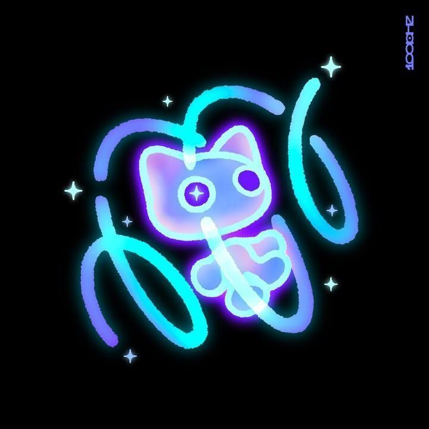
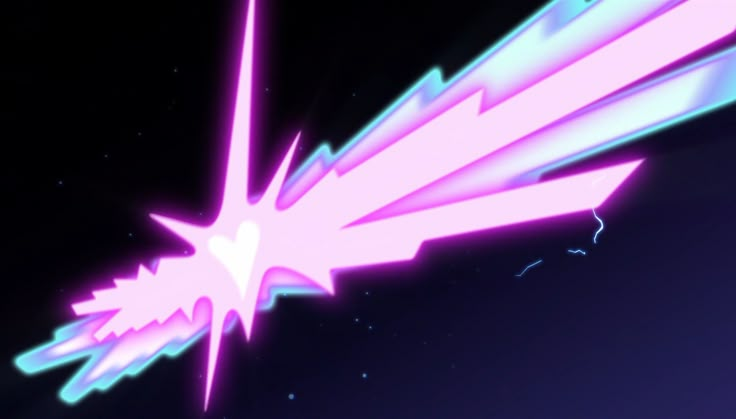

<!--
  ✦ bricita / Brigitte Vásquez
  Paleta: #090713 · #A68BFF · #FF91E8 · #83F7FF
  Diseño personal inspirado en un universo pastel-neón.
  Imágenes proporcionadas por Brigitte. Puedes cambiarlas en /assets.
-->

  

 
 

✦ WELCOME TO MY LITTLE UNIVERSE ✦

# 𝘉𝘳𝘪𝘨𝘪𝘵𝘵𝘦 𝘝𝘢́𝘴𝘲𝘶𝘦𝘻 ✧

**Estrategia & Planificación · Diseño UI/UX · Desarrollo Full Stack**

*Me gusta encontrar el sentido detrás de cada idea, darle forma con diseño y convertirla en algo real.*

 

<table>
<tr>
<td width="65%" valign="top">

### `01 / whoami` 🌙

¡Hola! Soy **Brigitte**. Me entusiasma crear experiencias digitales, pero sobre todo **entender los problemas antes de pensar en las soluciones**.

Me encanta investigar, organizar ideas, planificar proyectos, pensar estrategias y explorar el diseño. También disfruto llevar todo ese proceso al código y aprender construyendo junto a otras personas.

**Lo que más me mueve:**

- Explorar necesidades y oportunidades.
- Conectar investigación, estrategia y planificación.
- Diseñar interfaces con intención y personalidad.
- Convertir ideas en productos funcionales.
- Crear en equipo y mejorar en cada iteración.

</td>
<td width="35%" align="center" valign="middle">

 
my tiny cosmic companion ✧
</td>
</tr>
</table>

### `02 / my creative orbit` ✨

**Entender** `→` **Imaginar** `→` **Planificar** `→` **Diseñar** `→` **Construir** `→` **Evolucionar**

Me importa tanto cómo funciona una solución como por qué existe y cómo la viven las personas.

 

### `03 / my toolbox` 🔮

**Ideas, organización y diseño**

**Desarrollo y herramientas**

 

 
✦ little spark, big ideas ✦

 

### `04 / selected works` 💫

> Una selección de proyectos propios y colaborativos. Algunos viven en las cuentas de mis compañeros: **también son parte de mi recorrido**.

| Proyecto | Universo | Explora |
|:--|:--|:--|
| **VapeOn** | App móvil desarrollada en equipo · Kotlin | [Repositorio ↗](https://github.com/Fabricio151205/AppMovil_VapeOn) |
| **JURIDIBASE** | Proyecto de diseño y arquitectura de software | [Repositorio ↗](https://github.com/bricita/Abogados_MiguelRojas_JURIDIBASE) |
| **Sistema jurídico · web** | Trabajo colaborativo con frontend TypeScript y backend Java | [Frontend ↗](https://github.com/Rebazzza/Frontend-Abogado_MiguelRojas) · [Backend ↗](https://github.com/Rebazzza/Backend-Abogado_MiguelRojas) |
| **AyudaYa** | Proyecto colaborativo · frontend web | [Repositorio ↗](https://github.com/Rebazzza/AyudaYa-Frontend) |
| **Granja El Nido** | Aplicación móvil · Kotlin | [Repositorio ↗](https://github.com/bricita/AppMovil_Granja_ElNido) |
| **Proyecto T3 Calidad** | Proyecto de calidad y pruebas de software | [Repositorio ↗](https://github.com/Fabricio151205/ProyectoT3Calidad) |
| **CRUD de Productos** | Aplicación Android e integración de API | [Repositorio ↗](https://github.com/bricita/Android-Studio_CRUDProductos) |

<b>✧ Otros proyectos y prácticas</b>

 

- [Control de Acceso · Android Studio](https://github.com/bricita/Control-de-Acceso---Android-Studio)
- [Mostrar Posts · Android Studio](https://github.com/bricita/Android-Studio_MostrarPosts)
- [CounterIncrement](https://github.com/bricita/CounterIncrement)
- [Ejercicios básicos Flutter](https://github.com/bricita/ejercicios_basicos_flutter)

 

### `05 / constellations of code` 🌟

 

Las estadísticas se basan en información pública y pueden no reflejar todas las contribuciones en repositorios ajenos o privados.

 

### `06 / let's connect` 🪐

**¿Una idea, un diseño o un proyecto por explorar?**

✧ Pienso con curiosidad · diseño con intención · construyo con propósito ✧

